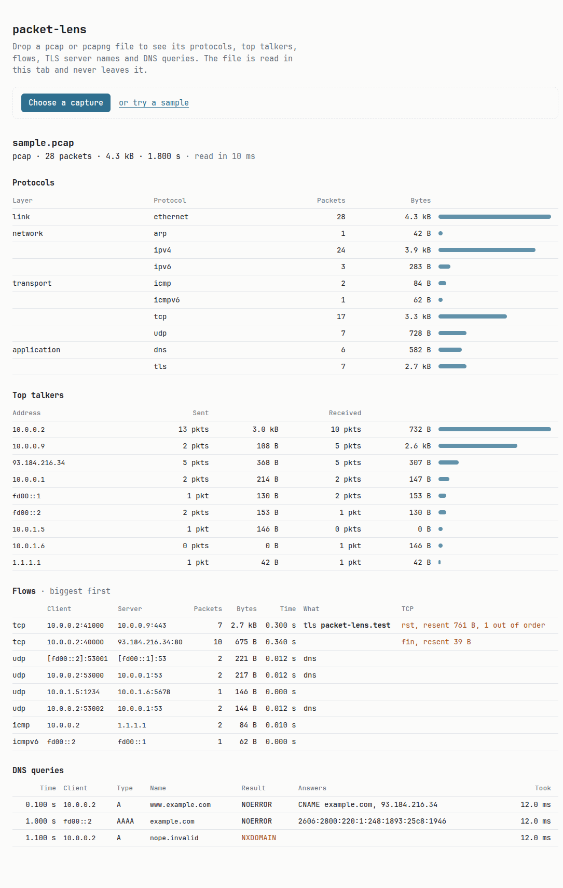

# packet-lens

Reads a pcap or pcapng capture and tells you what is in it: protocols, top talkers, flows, TLS server names and DNS queries. The core is plain Rust. It runs as a CLI, or compiled to WebAssembly in a web page where the file never leaves the browser tab.

**Live demo:** https://varunagarwalofficial.github.io/packet-lens/ (the capture stays in your browser).



What it reads:

- **Files:** pcap in either byte order with micro or nanosecond times, and pcapng with several sections and interfaces and per-interface time resolution.
- **Links:** Ethernet (with VLAN and QinQ tags), Linux cooked v1 and v2, BSD loopback and raw IP.
- **Packets:** IPv4, IPv6 (walking extension headers), ARP, TCP, UDP, ICMP and ICMPv6.
- **TCP:** each direction is put back in order, so a flow shows bytes sent twice, segments that came early and gaps that never filled. Sequence numbers may wrap.
- **TLS:** the server name from the ClientHello, after reassembly, so a hello split across segments or records, or sent out of order, still counts.
- **DNS:** queries matched to replies by client address, port and query id, with the result code, the answers and how long the reply took. Compression pointers that loop or point forward are rejected.

A cut or damaged file gives what could be read and a note of where it stopped. It does not panic: the tests cut fixtures at every byte, and set every byte to 0x00 and then 0xff. Large captures are capped at 100 talkers, 1000 flows and 5000 DNS entries in the report, but the totals stay exact.

## Run it

You need stable Rust. The web page also needs the `wasm32-unknown-unknown` target (`rustup target add wasm32-unknown-unknown`) and Python for the local server.

```sh
make build
target/release/packet-lens capture.pcapng            # text report
target/release/packet-lens capture.pcapng -n 25      # longer lists
target/release/packet-lens capture.pcapng --json     # the full report

make serve                                           # then open http://localhost:8000
```

The page is static: `index.html`, a little JavaScript and the 200 kB wasm module. Serve `web/` from anywhere after `make web`. Its content security policy allows no requests beyond its own files.

## Tests

```sh
make check    # Rust tests, then the wasm module through the page's loader in node
make lint     # rustfmt and clippy, Biome for the page, ruff for the fixture script
make fixtures # rewrite the captures in tests/fixtures (needs uv; uses scapy)
```

The captures in `tests/fixtures` are made by `make.py`, so each test knows exactly what is in them: a DNS exchange over IPv4 and IPv6, an NXDOMAIN, an HTTP flow with a resent segment, ICMP, ARP and a VLAN-tagged packet, written as pcap in both byte orders, nanosecond pcap and pcapng. All four must give the same report. `tls.pcap` holds a real OpenSSL ClientHello split in two, sent second half first, with sequence numbers that wrap mid-hello. Its random parts change each time the script runs; the tests do not look at them.

## Layout

```
crates/packet-lens/   the library
  capture.rs            pcap and pcapng files
  decode.rs             link, network and transport headers
  stream.rs             TCP reassembly
  tls.rs, dns.rs        application protocols
  analysis.rs           the report
crates/cli/           the packet-lens command
crates/wasm/          the C ABI the page calls: alloc, analyse, free
web/                  the page
tests/fixtures/       captures and the script that makes them
```

The wasm module has no imports and no wasm-bindgen. The page copies the file into the module's memory, and the report comes back as JSON with a length in front. It is the same boundary as in my earlier net-visual project.

## Status

27 November 2026. Works on the fixtures, from the CLI and in the page. CI runs `make check` and `make lint` on every push and passes. Not yet tried on large real-world captures. See [STATUS.md](STATUS.md).

## Licence

MIT. See [LICENSE](LICENSE).
